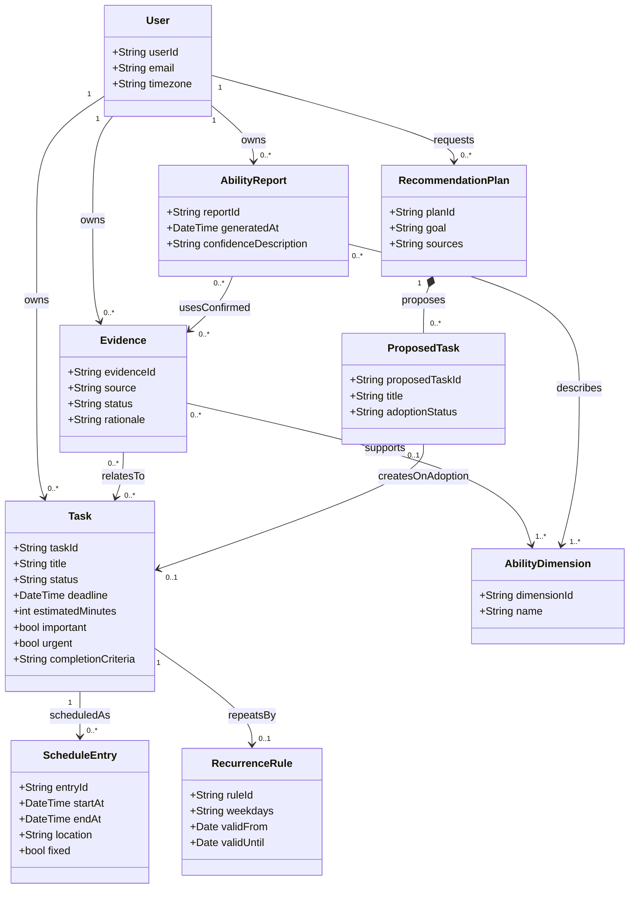

# StudyPilot 学生成长规划系统功能规格说明书

## 1. 系统角色（Actor）

### 1.1 人类角色

| 角色 | 职责 |
|---|---|
| 学生用户 | 登录系统，录入和管理任务，校正识别结果，调整四象限分类，查看计划，确认能力证据，查看报告并选择是否采纳推荐 |

### 1.2 系统外部角色

| 角色 | 职责 |
|---|---|
| 大模型服务 | 为信息提取、任务分类、计划建议、证据整理及报告生成提供支持 |
| 网络检索服务 | 为长期准备方案提供可追溯的公开参考信息 |

### 1.3 内部智能处理职责

| 编号 | 职责名称 | 工作内容 |
|---|---|---|
| AG-1 | 日程识别 | 提取文字及课表图片中的课程、时间、地点和截止时间等信息 |
| AG-2 | 规划辅助 | 建议四象限类别与执行时间，生成长期任务准备方案 |
| AG-3 | 成长分析 | 整理候选能力证据，根据已确认的证据生成报告与建议 |

上述划分用于说明系统职责，不要求实现为三个独立部署的智能体。

## 2. 功能树（Feature Tree）

### 2.1 用户登录模块

- FR-1.1 邮箱密码登录：系统应支持用户通过邮箱和密码登录，登录成功后进入个人计划页面。
- FR-1.2 登录失败处理：凭据校验失败时，系统应提示登录失败并允许重新输入；必要字段为空时应提示补充。
- FR-1.3 退出登录：系统应支持退出登录；退出后再次访问个人数据页面时应要求重新登录。
- FR-1.4 个人数据访问：用户应只能查看和操作本人任务、作品、能力证据及能力报告。

### 2.2 日程录入与管理模块

- FR-2.1 手动管理：系统应支持手动新增、查看、修改和删除任务及其日程安排。
- FR-2.2 文本识别：系统应支持输入通知、比赛说明等自然语言文本，提取任务名称、起止时间、地点和截止时间等已明确的信息。
- FR-2.3 课表图片识别：系统应支持上传课表图片，提取课程名称、星期、节次或起止时间、地点、教学周及重复规则等可识别内容。具体支持格式及大小限制见第 7 节。
- FR-2.4 识别结果确认：识别结果应作为待确认内容展示，允许用户逐项修改、选择导入或取消；只有用户确认的条目才能写入正式日程。
- FR-2.5 缺失及歧义处理：对缺失、无法辨认或存在歧义的必要字段，系统应提示补充或选择，不得将猜测值直接作为确定信息保存。
- FR-2.6 学期与节次设置：课表仅提供教学周和节次时，系统应支持设置学期第一周起始日期及节次对应时间，再换算实际日程。
- FR-2.7 重复日程：系统应支持按星期及生效日期范围设置重复课程，并据此生成对应日期的日程。
- FR-2.8 重复日程编辑：修改或删除重复日程时，应允许用户选择仅本次或整个系列，并展示影响范围。系列修改应重新检查受影响日期的时间冲突。
- FR-2.9 来源保留：通过识别生成的任务应保留可供用户查看的录入来源及确认结果，便于后续核对。

### 2.3 四象限时间管理模块

- FR-3.1 分类建议：智能体应结合任务描述、截止时间和用户目标，分别判断重要性与紧急性，生成四象限分类建议及简要依据。
- FR-3.2 四象限展示：计划页面右侧应显示四个独立区域，分别对应四类任务。
- FR-3.3 象限摘要：每个象限应显示当前统计范围内未完成任务数量、最近截止时间和任务摘要；无截止时间时显示“未设置”，无任务时显示空状态。
- FR-3.4 重点提示：重要且紧急象限应通过颜色、边框或标识进行明显区分，并提供文字标签。
- FR-3.5 人工调整：用户应能够修改任务类别，修改后每日计划标签、象限位置及统计数量应同步更新。
- FR-3.6 完成状态同步：任务完成或恢复未完成时，四象限与每日计划应同步变化；已完成任务可显示划线，并从未完成数量中移除。
- FR-3.7 分类更新建议：任务临近截止时间时，系统可重新给出紧急性建议；对用户手动设置的类别，应由用户确认后再改变。

### 2.4 每日计划与日历模块

- FR-4.1 日期导航：系统应提供按真实日期组织的日历视图，支持切换月份、年份、选择日期及返回今天。
- FR-4.2 每日计划分区：页面左侧应展示选中日期的每日计划，上部展示固定时间任务，下部展示非固定任务。
- FR-4.3 固定任务展示：固定任务应以课表或时间轴呈现，包含开始时间、结束时间、地点、重复规则和四象限标签，并按开始时间排序。
- FR-4.4 时间冲突检测：新增或修改固定安排时，系统应检查与已有固定安排的重叠情况，展示冲突对象，并允许修改、取消本次操作或同时保留。
- FR-4.5 非固定任务展示：非固定任务应展示完成状态、DDL、预计时长、建议时间、能力关联、四象限标签和完成标准；未设置的字段应提供明确占位提示。
- FR-4.6 非固定任务排序：默认按 DDL 从近到远排序；相同 DDL 时按四象限优先级排列，再按预计时长排列。具体顺序见 BR-3。
- FR-4.7 执行时间建议：系统应结合已有固定安排、DDL 和预计时长给出执行时段建议，用户确认后生成日程安排；建议不能满足约束时应说明原因。
- FR-4.8 任务状态管理：用户应能够标记任务完成或恢复未完成；状态变更应同步至每日计划和四象限视图。
- FR-4.9 跨日安排：同一任务需要分多次执行时，系统应支持关联多个日程安排，并保持同一个任务身份，避免被统计为多个独立任务。

本节的日历视图不代表已实现 ICS 文件导入导出或第三方日历同步。

### 2.5 能力证据与报告模块

- FR-5.1 能力维度：系统应围绕以下六个维度组织证据和报告：问题发现与研究设计、计算与系统思维、实验验证与数据素养、批判性与独立思考、信息素养与学术规范、表达协作与反思。
- FR-5.2 材料录入：系统应支持记录任务行为、上传或粘贴阶段作品及研究成果、录入用户自述和外部反馈。
- FR-5.3 候选证据生成：智能体应基于材料生成候选证据，说明来源、关联能力维度及关联依据。完成速度、数量和任务偏好可作为行为信息，不应单独作为能力水平结论。
- FR-5.4 证据确认：用户应能够接受、修改、拒绝候选证据，或标记为待观察。修改后应由用户确认其最终内容。
- FR-5.5 正式报告更新：只有已确认的证据才能参与正式报告生成；待确认、被拒绝或待观察的证据不得更新正式报告。
- FR-5.6 报告内容：报告应显示能力水平、趋势、置信度、证据数量、主要证据和下一步建议。能力水平允许采用数值、等级或定性描述，不强制统一为 0—100 分。
- FR-5.7 证据追溯：用户应能够从报告结论查看支撑证据及其来源；证据不足时应显示“证据不足”或“暂无法判断”。
- FR-5.8 报告更新记录：系统应记录报告生成时间和证据范围；缺少可比历史记录时，不应直接给出上升或下降趋势。
- FR-5.9 证据修正：用户撤回或修正已确认的证据后，系统应更新受影响的当前报告，并标明更新时间。

### 2.6 个性化推荐模块

- FR-6.1 目标信息收集：用户输入比赛、论文、考核等准备型任务时，系统应支持收集目标、截止时间、已有基础、可投入时间及其他约束。
- FR-6.2 准备方案生成：智能体应结合已确认的能力记录、用户输入及网络检索结果生成分阶段准备方案。
- FR-6.3 子任务描述：方案应说明阶段目标、建议子任务、预计时长、建议时间和完成标准，并说明主要推荐依据。
- FR-6.4 来源展示：涉及网络资料的建议应提供来源链接；涉及报名、截止日期等时效信息时，应说明适用日期及查询时间，无法核实时应明确标注。
- FR-6.5 方案选择：用户应能够全部采纳、部分采纳、修改或拒绝方案；仅被确认采纳的子任务才能加入正式任务列表。
- FR-6.6 安排冲突处理：采纳方案并生成具体日程时，应执行与固定安排相同的冲突检查。
- FR-6.7 冷启动支持：缺少能力报告时，系统应允许根据用户自述和目标生成初步方案，并说明依据有限。
- FR-6.8 外部服务失败处理：检索失败时，系统应说明未取得外部参考信息，允许用户重试，或选择基于已有信息生成方案，不得将未检索到的内容标为已核实。

## 3. 领域模型（Domain Model UML）

下图表达业务对象及关系，不限定数据库表结构、编程语言或智能体部署方式。

补充约束：正式报告只能引用已确认的证据；推荐方案中的子任务在采纳前不属于正式任务；课程的各次安排通过任务关联同一重复规则。

