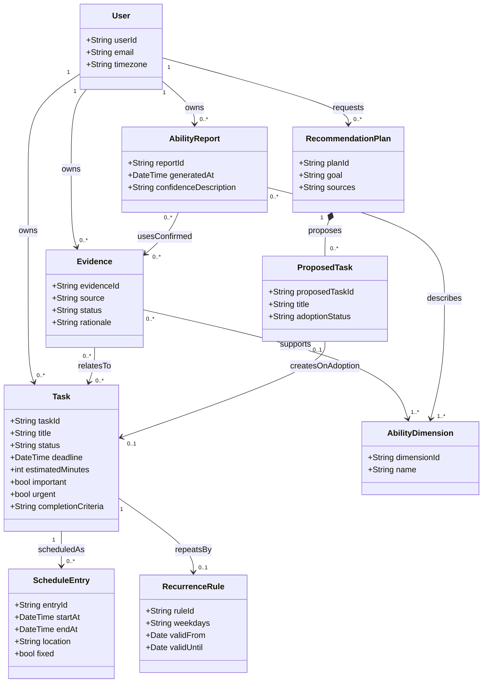

# StudyPilot 学生成长规划系统功能规格说明书

## 0. 文档信息

| 项目 | 内容 |
|---|---|
| 系统名称 | StudyPilot 学生成长规划系统 |
| 文档版本 | v1.0 参考草案 |
| 编写日期 | 2026-10-24 |
| 适用范围 | 用户登录、日程录入、四象限管理、每日计划、能力报告及个性化推荐 |
| 编号规则 | FR-x.y 表示功能需求，NFR-x 表示非功能需求，AC-x 表示验收标准 |
| 文档性质 | 根据现有需求整理的讨论稿；补充规则为建议约定，需经项目组确认后作为实现与验收依据 |

### 0.1 系统目标

系统面向学生用户，将课程、通知和长期准备任务转化为可管理的日程，通过四象限分类辅助时间规划，并结合经用户确认的证据形成能力报告，为比赛、论文和考核等目标提供个性化准备建议。

### 0.2 术语说明

| 术语 | 含义 |
|---|---|
| 任务 | 需要完成的事项，可包含截止时间、预计时长和完成标准 |
| 固定时间任务 | 已确定起止时间的事项，例如课程、会议和考试 |
| 非固定任务 | 尚未确定执行时段的事项，例如论文阅读、报告撰写 |
| 日程安排 | 任务在具体日期上的执行时段；同一任务可以有多个安排 |
| DDL | 截止时间 |
| 四象限 | 重要且紧急、重要不紧急、不重要但紧急、不重要不紧急 |
| 候选证据 | 智能体根据行为或成果材料生成、尚未经用户确认的能力关联记录 |
| 正式能力报告 | 根据已确认能力证据生成的能力描述与建议 |
| ICS | iCalendar 日历文件的常用扩展名；文件导入导出与外部日历实时同步属于不同功能 |

### 0.3 范围约定

本草案以单个学生管理个人任务与成长记录为范围，不默认包含管理后台或多人协作。课表图片识别纳入拟议功能；账号注册、ICS 导入导出、第三方日历同步等尚未确定的能力列于第 7 节。

## 1. 系统角色（Actor）

### 1.1 人类角色

| 角色 | 职责 |
|---|---|
| 学生用户 | 登录系统，录入和管理任务，校正识别结果，调整四象限分类，查看计划，确认能力证据，查看报告并选择是否采纳推荐 |

### 1.2 系统外部角色

| 角色 | 职责 |
|---|---|
| 大模型服务 | 为信息提取、任务分类、计划建议、证据整理及报告生成提供支持 |
| 网络检索服务 | 为长期准备方案提供可追溯的公开参考信息 |

外部反馈在本版本中由学生录入或上传，不默认要求教师等反馈者拥有系统账号。若后续接入外部日历，应另外补充外部日历服务角色及接口范围。

### 1.3 内部智能处理职责

| 编号 | 职责名称 | 工作内容 |
|---|---|---|
| AG-1 | 日程识别 | 提取文字及课表图片中的课程、时间、地点和截止时间等信息 |
| AG-2 | 规划辅助 | 建议四象限类别与执行时间，生成长期任务准备方案 |
| AG-3 | 成长分析 | 整理候选能力证据，根据已确认的证据生成报告与建议 |

上述划分用于说明系统职责，不要求实现为三个独立部署的智能体。

## 2. 功能树（Feature Tree）

### 2.1 用户登录模块

- **FR-1.1 邮箱密码登录：**系统应支持用户通过邮箱和密码登录，登录成功后进入个人计划页面。
- **FR-1.2 登录失败处理：**凭据校验失败时，系统应提示登录失败并允许重新输入；必要字段为空时应提示补充。
- **FR-1.3 退出登录：**系统应支持退出登录；退出后再次访问个人数据页面时应要求重新登录。
- **FR-1.4 个人数据访问：**用户应只能查看和操作本人任务、作品、能力证据及能力报告。

### 2.2 日程录入与管理模块

- **FR-2.1 手动管理：**系统应支持手动新增、查看、修改和删除任务及其日程安排。
- **FR-2.2 文本识别：**系统应支持输入通知、比赛说明等自然语言文本，提取任务名称、起止时间、地点和截止时间等已明确的信息。
- **FR-2.3 课表图片识别：**系统应支持上传课表图片，提取课程名称、星期、节次或起止时间、地点、教学周及重复规则等可识别内容。具体支持格式及大小限制见第 7 节。
- **FR-2.4 识别结果确认：**识别结果应作为待确认内容展示，允许用户逐项修改、选择导入或取消；只有用户确认的条目才能写入正式日程。
- **FR-2.5 缺失及歧义处理：**对缺失、无法辨认或存在歧义的必要字段，系统应提示补充或选择，不得将猜测值直接作为确定信息保存。
- **FR-2.6 学期与节次设置：**课表仅提供教学周和节次时，系统应支持设置学期第一周起始日期及节次对应时间，再换算实际日程。
- **FR-2.7 重复日程：**系统应支持按星期及生效日期范围设置重复课程，并据此生成对应日期的日程。
- **FR-2.8 重复日程编辑：**修改或删除重复日程时，应允许用户选择仅本次或整个系列，并展示影响范围。系列修改应重新检查受影响日期的时间冲突。
- **FR-2.9 来源保留：**通过识别生成的任务应保留可供用户查看的录入来源及确认结果，便于后续核对。

### 2.3 四象限时间管理模块

- **FR-3.1 分类建议：**智能体应结合任务描述、截止时间和用户目标，分别判断重要性与紧急性，生成四象限分类建议及简要依据。
- **FR-3.2 四象限展示：**计划页面右侧应显示四个独立区域，分别对应四类任务。
- **FR-3.3 象限摘要：**每个象限应显示当前统计范围内未完成任务数量、最近截止时间和任务摘要；无截止时间时显示“未设置”，无任务时显示空状态。
- **FR-3.4 重点提示：**重要且紧急象限应通过颜色、边框或标识进行明显区分，并提供文字标签。
- **FR-3.5 人工调整：**用户应能够修改任务类别，修改后每日计划标签、象限位置及统计数量应同步更新。
- **FR-3.6 完成状态同步：**任务完成或恢复未完成时，四象限与每日计划应同步变化；已完成任务可显示划线，并从未完成数量中移除。
- **FR-3.7 分类更新建议：**任务临近截止时间时，系统可重新给出紧急性建议；对用户手动设置的类别，应由用户确认后再改变。

### 2.4 每日计划与日历模块

- **FR-4.1 日期导航：**系统应提供按真实日期组织的日历视图，支持切换月份、年份、选择日期及返回今天。
- **FR-4.2 每日计划分区：**页面左侧应展示选中日期的每日计划，上部展示固定时间任务，下部展示非固定任务。
- **FR-4.3 固定任务展示：**固定任务应以课表或时间轴呈现，包含开始时间、结束时间、地点、重复规则和四象限标签，并按开始时间排序。
- **FR-4.4 时间冲突检测：**新增或修改固定安排时，系统应检查与已有固定安排的重叠情况，展示冲突对象，并允许修改、取消本次操作或同时保留。
- **FR-4.5 非固定任务展示：**非固定任务应展示完成状态、DDL、预计时长、建议时间、能力关联、四象限标签和完成标准；未设置的字段应提供明确占位提示。
- **FR-4.6 非固定任务排序：**默认按 DDL 从近到远排序；相同 DDL 时按四象限优先级排列，再按预计时长排列。具体顺序见 BR-3。
- **FR-4.7 执行时间建议：**系统应结合已有固定安排、DDL 和预计时长给出执行时段建议，用户确认后生成日程安排；建议不能满足约束时应说明原因。
- **FR-4.8 任务状态管理：**用户应能够标记任务完成或恢复未完成；状态变更应同步至每日计划和四象限视图。
- **FR-4.9 跨日安排：**同一任务需要分多次执行时，系统应支持关联多个日程安排，并保持同一个任务身份，避免被统计为多个独立任务。

本节的日历视图不代表已实现 ICS 文件导入导出或第三方日历同步。

### 2.5 能力证据与报告模块

- **FR-5.1 能力维度：**系统应围绕以下六个维度组织证据和报告：问题发现与研究设计、计算与系统思维、实验验证与数据素养、批判性与独立思考、信息素养与学术规范、表达协作与反思。
- **FR-5.2 材料录入：**系统应支持记录任务行为、上传或粘贴阶段作品及研究成果、录入用户自述和外部反馈。
- **FR-5.3 候选证据生成：**智能体应基于材料生成候选证据，说明来源、关联能力维度及关联依据。完成速度、数量和任务偏好可作为行为信息，不应单独作为能力水平结论。
- **FR-5.4 证据确认：**用户应能够接受、修改、拒绝候选证据，或标记为待观察。修改后应由用户确认其最终内容。
- **FR-5.5 正式报告更新：**只有已确认的证据才能参与正式报告生成；待确认、被拒绝或待观察的证据不得更新正式报告。
- **FR-5.6 报告内容：**报告应显示能力水平、趋势、置信度、证据数量、主要证据和下一步建议。能力水平允许采用数值、等级或定性描述，不强制统一为 0—100 分。
- **FR-5.7 证据追溯：**用户应能够从报告结论查看支撑证据及其来源；证据不足时应显示“证据不足”或“暂无法判断”。
- **FR-5.8 报告更新记录：**系统应记录报告生成时间和证据范围；缺少可比历史记录时，不应直接给出上升或下降趋势。
- **FR-5.9 证据修正：**用户撤回或修正已确认的证据后，系统应更新受影响的当前报告，并标明更新时间。

### 2.6 个性化推荐模块

- **FR-6.1 目标信息收集：**用户输入比赛、论文、考核等准备型任务时，系统应支持收集目标、截止时间、已有基础、可投入时间及其他约束。
- **FR-6.2 准备方案生成：**智能体应结合已确认的能力记录、用户输入及网络检索结果生成分阶段准备方案。
- **FR-6.3 子任务描述：**方案应说明阶段目标、建议子任务、预计时长、建议时间和完成标准，并说明主要推荐依据。
- **FR-6.4 来源展示：**涉及网络资料的建议应提供来源链接；涉及报名、截止日期等时效信息时，应说明适用日期及查询时间，无法核实时应明确标注。
- **FR-6.5 方案选择：**用户应能够全部采纳、部分采纳、修改或拒绝方案；仅被确认采纳的子任务才能加入正式任务列表。
- **FR-6.6 安排冲突处理：**采纳方案并生成具体日程时，应执行与固定安排相同的冲突检查。
- **FR-6.7 冷启动支持：**缺少能力报告时，系统应允许根据用户自述和目标生成初步方案，并说明依据有限。
- **FR-6.8 外部服务失败处理：**检索失败时，系统应说明未取得外部参考信息，允许用户重试，或选择基于已有信息生成方案，不得将未检索到的内容标为已核实。

## 3. 业务规则与非功能需求

### 3.1 业务规则（建议约定）

| 编号 | 规则 |
|---|---|
| BR-1 | 固定日程采用左闭右开时间区间；前一任务结束时间等于后一任务开始时间时，不判为时间重叠。结束时间必须晚于开始时间 |
| BR-2 | 四象限摘要默认统计当前用户全部未完成任务，与每日计划的单日日期筛选区分；界面应标明统计范围 |
| BR-3 | 非固定任务先按 DDL 升序，无 DDL 的任务排在有 DDL 的任务之后；相同 DDL 时依次为重要且紧急、重要不紧急、不重要但紧急、不重要不紧急，再按预计时长从短到长排列；预计时长为空时排在同组末尾 |
| BR-4 | 每日非固定列表展示已安排在选中日期的非固定任务，以及截至该日仍未完成且已到期的任务；尚未安排且未到期的事项在待安排列表展示 |
| BR-5 | 同一任务关联多个日程安排时，四象限按任务去重计数；完成某个执行时段不自动表示整个任务完成 |
| BR-6 | 重要性与紧急性分别判断；截止时间临近不自动意味着任务重要 |
| BR-7 | 无 DDL 不等于不紧急；具体紧急性规则、阈值及用户目标设置方式需由项目组确认 |
| BR-8 | 系统应使用明确的用户时区展示和比较时间；初始默认值与修改方式见第 7 节 |
| BR-9 | 外部反馈在本版本中属于用户提供的材料，应保留来源说明，不默认表示反馈者身份已经由系统核验 |

上述规则是为消除原始需求歧义提出的初稿，可在讨论后调整，但应在开发和验收前确定。

### 3.2 非功能需求

| 编号 | 类别 | 需求描述 |
|---|---|---|
| NFR-1 | 可用性 | 必要字段缺失、输入无效和处理失败时，应提供可理解的提示并保留可恢复的已输入内容 |
| NFR-2 | 可靠性 | 智能处理失败不应影响已保存的任务，用户应能够重试或改为手动录入 |
| NFR-3 | 一致性 | 同一任务的状态和分类应在每日计划、四象限及任务详情中保持一致 |
| NFR-4 | 防重复 | 对同一次提交的重复点击或请求重试，不应生成重复任务或重复采纳记录 |
| NFR-5 | 安全性 | 密码不得明文存储；访问个人任务、作品和报告时应校验用户身份及数据归属 |
| NFR-6 | 可追溯性 | 正式能力报告结论应关联已确认的证据；网络推荐应关联实际取得的来源 |
| NFR-7 | 支持性 | 应记录关键错误和必要上下文以便排查，不在错误日志中记录明文密码等敏感信息 |
| NFR-8 | 性能 | 应分别约定普通交互和智能处理的响应时间、超时策略及测试环境；量化阈值见第 7 节，未确定前不得作为已达成指标 |
| NFR-9 | 可访问性 | 四象限分类和状态应提供文字标识，不能仅依靠颜色传达信息 |

## 4. 典型业务流程

### 4.1 课表图片录入

1. 用户上传课表图片。
2. 系统识别课程名称、星期、时间、地点和教学周等信息。
3. 必要时，用户补充学期起始日期、节次时间及无法识别的字段。
4. 用户校正结果并选择需要导入的课程。
5. 系统按重复规则展开日程，检查受影响日期的时间冲突。
6. 用户处理冲突并确认保存，日历和每日计划更新。

识别失败时，系统保留可恢复的输入，允许重新上传或手动添加。

### 4.2 长期目标规划

1. 用户输入比赛、论文或考核目标及相关说明。
2. 系统提示补充截止时间、基础与可投入时间。
3. 智能体结合已确认能力记录和外部信息生成准备方案。
4. 用户查看依据，修改并选择采纳的子任务。
5. 系统创建被采纳的任务；如需生成具体执行时段，则检查日程冲突。
6. 用户确认安排，相关任务在每日计划和四象限中展示。

### 4.3 能力报告更新

1. 用户执行任务并提交作品、自述或反馈材料。
2. 系统生成候选证据，说明关联维度与依据。
3. 用户接受、修改、拒绝或标记为待观察。
4. 系统仅使用已确认的证据更新正式能力报告。
5. 用户查看报告，并可追溯每项结论的支撑材料。

## 5. 领域模型（Domain Model UML）

下图表达业务对象及关系，不限定数据库表结构、编程语言或智能体部署方式。

补充约束：正式报告只能引用已确认的证据；推荐方案中的子任务在采纳前不属于正式任务；课程的各次安排通过任务关联同一重复规则。

## 6. 验收标准

| 编号 | 关联需求 | 检查条件与预期结果 |
|---|---|---|
| AC-1 | FR-1.1—FR-1.3 | 使用有效账号可登录；无效凭据有失败提示；退出后再次访问个人页面需登录 |
| AC-2 | FR-1.4、NFR-5 | 使用两个测试账号，任一账号均不能通过页面或接口访问另一账号的个人记录 |
| AC-3 | FR-2.2、FR-2.4 | 输入明确包含事项、时间和地点的文本，可查看和编辑提取结果；确认前无正式日程，确认后保存值与最终确认内容一致 |
| AC-4 | FR-2.3、FR-2.5、FR-2.6 | 上传项目组约定的课表样例，可校正识别结果；缺少学期或节次映射时提示补充，补齐后日期及时间与样例预期一致 |
| AC-5 | FR-2.7、FR-2.8 | 重复课程仅在规则覆盖日期生成；仅修改本次不改变其他日期，修改系列时明确影响范围 |
| AC-6 | FR-3.3、FR-3.5、FR-3.6 | 修改类别或完成状态后，象限位置、未完成数量及每日计划状态同步更新 |
| AC-7 | FR-4.1 | 可查看上月、下月、跨年日期，返回今天后选中系统当前用户时区的当天 |
| AC-8 | FR-4.4、BR-1 | 重叠任务出现冲突提示；首尾相接不判为重叠；用户可修改、取消或同时保留 |
| AC-9 | FR-4.6、BR-3 | 对包含相同 DDL、不同类别、不同预计时长和空值的固定测试集，结果顺序符合 BR-3 |
| AC-10 | FR-4.9、BR-5 | 同一任务分两天安排时，各日显示对应时段，四象限仍只计为一个任务 |
| AC-11 | FR-5.4、FR-5.5 | 候选证据处于待确认、拒绝或待观察状态时不影响正式报告；用户接受后才参与更新 |
| AC-12 | FR-5.6—FR-5.9 | 证据不足时显示不足提示；有结论时可追溯来源；撤回已确认的证据后当前报告相应更新 |
| AC-13 | FR-6.5、NFR-4 | 在多个建议子任务中仅采纳部分，系统仅新增所选任务；重复点击确认不重复新增 |
| AC-14 | FR-6.7、FR-6.8 | 无能力记录时可使用用户自述生成初步方案；模拟检索失败时显示失败说明并提供重试或有限信息生成路径 |

智能识别准确率、性能阈值等量化验收需在样例集、运行环境及测量口径确定后补充，不以本草案中的功能可用检查代替准确率测试。

## 7. 待项目组确认事项

| 编号 | 待确认问题 | 建议方向 |
|---|---|---|
| TBD-1 | 账号如何获取，是否包含注册、邮箱验证和密码找回？ | 若由预置账号演示，应在版本范围中说明 |
| TBD-2 | 是否实现 ICS 导入、导出或第三方日历同步？ | 分别确认，不将日历视图等同于实时同步 |
| TBD-3 | 课表图片支持格式、大小和识别测试集是什么？ | 初期可约定 PNG/JPG 和少量代表样例，再确定准确率目标 |
| TBD-4 | 是否支持单双周、跨周区间和节假日调课？ | 根据课程实际情况确定首版范围，并补充对应重复规则 |
| TBD-5 | 如何判定紧急性，是否可由用户配置阈值？ | 明确规则、时间单位以及用户覆盖方式 |
| TBD-6 | 是否接受 BR-2、BR-3、BR-4 中的统计、排序及每日任务范围？ | 开发前统一，避免不同页面口径不一致 |
| TBD-7 | 默认时区是什么，是否允许修改？ | 所有日期展示、DDL 比较及冲突检测采用一致口径 |
| TBD-8 | 六维能力如何描述，置信度如何表达？ | 初期可采用有依据的定性描述，避免直接输出缺乏定义的分数或概率 |
| TBD-9 | 作品附件的格式、大小、保留期限及删除规则是什么？ | 根据演示和实际使用需求设置明确范围 |
| TBD-10 | 普通交互、图片识别及方案生成的响应时间与超时条件是什么？ | 在确定网络、模型及并发条件后设定可测量目标 |
| TBD-11 | 是否提供系统通知、到期提醒或站外消息？ | 现有范围不默认包含主动提醒；如需实现，应补充渠道与触发规则 |

## 8. 参考资料与编写说明

- [功能规格格式参考：AIAgentFunSpec.md](https://github.com/bettermorn/AIAgent/blob/main/docs/AIAgentFunSpec.md)
- [原始需求：functional_spec.md](https://github.com/xddb4/agent-practice-demo/blob/develop/docs/requirements/functional_spec.md)

本稿沿用参考文档的角色、功能树、非功能需求、业务流程、领域模型和验收结构，结合 StudyPilot 的六个核心模块整理。新增业务规则、异常处理及待确认项用于辅助讨论，不代表已实现功能，也不构成对某一标准的合规声明。本稿仅作为独立参考文件，未修改源仓库。
