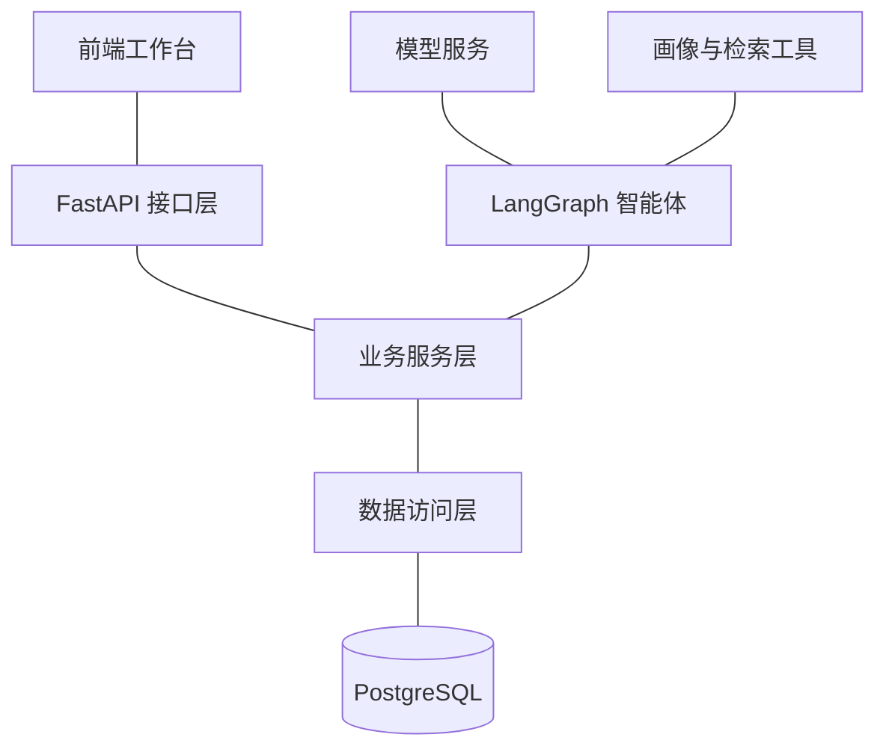
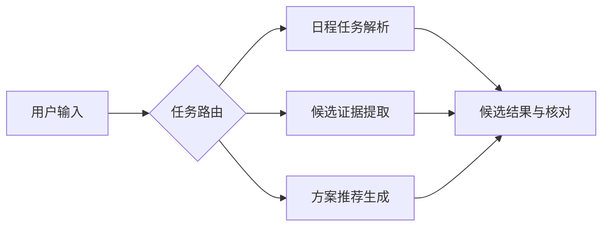
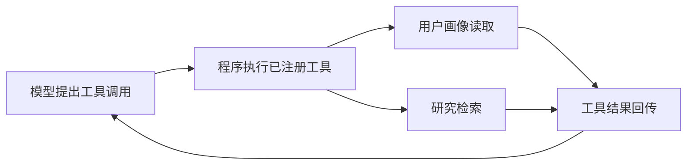
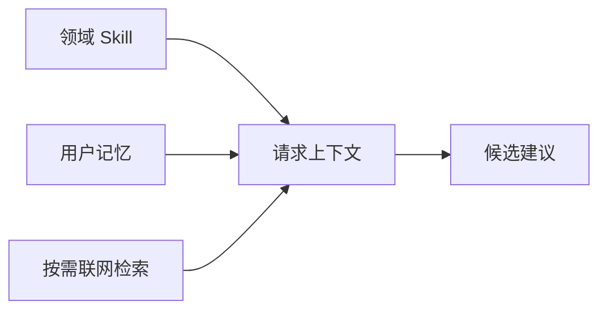
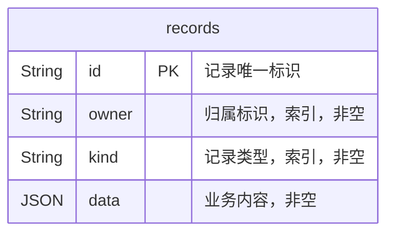

# StudyPilot

## Capability & Time Planning Agent

让每一次时间投入，都能积累成长的证据

创新工程实践营 · 项目答辩

<!--
五位团队成员及分工：最后统一补充。
-->

---
layout: default
---

# Mission, Slogan & Target Users

产品使命、口号与目标用户

### 产品使命

帮助本科生把学习与科研目标转化为可执行的计划，并通过行为与成果记录成长。

### 产品口号

让每一次时间投入，都能积累成长的证据。

### 目标用户

需要兼顾课程、科研与竞赛的本科生。

### 典型需求

- 任务多，需要明确优先级
- 日程满，需要安排可执行的计划
- 希望依据成果与复盘了解能力变化

<!--
对应老师要求：1.1.1 使命、1.1.2 口号、1.1.3 目标用户。
讲解建议：约25秒。
用户获取策略、团队优势与差异化在后续页面说明。
-->

---
layout: default
---

# User Acquisition & Team Strengths

用户获取策略与团队优势

### 用户获取策略（计划）

- **首批试用**：邀请身边有课程、科研或竞赛规划需求的同学体验
- **场景推广**：通过班级、实验室与竞赛小组分享使用案例
- **反馈迭代**：收集计划采纳情况与使用困难，改进核心流程

### 团队优势

待补充五位成员的专业背景、职责与协作优势。

<!--
对应老师要求：1.1.4 如何获得用户、1.1.5 团队优势。
用户获取策略为拟议方案，不代表已经开展推广或获得用户。
团队优势在确认五位成员的实际情况后补充。
-->

---
layout: default
---

# Product Differentiation

差异化设计：将时间规划与能力证据关联

| 比较维度 | 单独使用待办清单或日历 | StudyPilot 的设计 |
| --- | --- | --- |
| 任务组织 | 记录事项、截止日期与日程 | 结合四象限与固定、弹性任务组织计划 |
| 目标执行 | 用户自行拆解并安排任务 | 根据目标与约束生成候选行动，供用户确认 |
| 成长记录 | 记录完成状态与投入时间 | 关联成果、复盘与能力证据 |
| 后续建议 | 用户自行回顾并调整 | 结合当前任务与已接受证据生成建议 |

核心设计：计划执行 → 行为与成果证据 → 成长反馈 → 下一轮建议

<!--
对应老师要求：1.1.6 如何做到差异化。
此表比较独立清单/日历的使用方式与本项目设计，
不代表所有现有产品都缺少相关功能，也不构成效果评测。
-->

---
layout: default
---

# Product Definition

产品定义与解决方案

对于需要兼顾课程、科研与竞赛的本科生，StudyPilot 是一个能力与时间规划 Web 智能体应用，帮助用户拆解目标、安排任务，并整理成长证据。

### 解决的问题

- 目标抽象，缺少近期可执行的行动
- 任务安排与已有日程脱节
- 完成记录与能力反馈缺少关联

### 解决方案

- 通过网页统一管理目标、任务与日程
- 生成候选方案，由用户核对并采纳
- 将成果与复盘整理为待确认的能力证据

差异化定位：在任务与日程管理基础上，关联执行证据与后续成长建议。

<!--
对应老师要求：1.2 产品定义、1.2.1 解决的问题、1.2.3 解决方案。
候选方案与能力证据均强调用户核对，避免将模型输出直接作为事实。
-->

---
layout: default
---

# User Stories

用户故事：谁在什么场景下，获得什么价值

| 用户 | 想完成的活动 | 希望获得的价值 |
| --- | --- | --- |
| 兼顾课程与科研的学生 | 根据课表和截止日期安排本周任务 | 减少时间冲突，明确每天先做什么 |
| 准备参加竞赛的学生 | 将备赛目标拆成近期可执行的行动 | 明确下一步，减少无从下手的情况 |
| 希望提升科研能力的学生 | 整理实验成果与阶段复盘 | 有依据地了解进步与不足，调整后续学习方向 |

共同诉求：知道下一步做什么、何时做，以及做完后积累了什么。

<!--
对应老师要求：1.2.2 对客户的价值。
使用用户、活动、价值描述需求，不使用技术实现语言。
这些是产品设计中的用户故事，不代表已验证的用户反馈。
讲解建议：约20秒，重点讲一个故事，其余简要带过。
-->

---
layout: default
---

# Product Design Principles

产品设计原则及其在 StudyPilot 中的应用

| 原则 | 具体设计 |
| --- | --- |
| 需求原则 | 围绕学生的目标拆解、时间安排与成长反馈组织功能 |
| 系统原则 | 将目标、任务、日程、证据与后续建议关联起来 |
| 简化原则 | 通过统一工作台查看日程、任务与四象限优先级 |
| 审核原则 | 模型生成候选内容，由用户核对后采纳 |
| 定量原则 | 记录完成情况与时间投入；能力判断结合证据及置信度 |

设计取舍：保留用户的修改与确认权，避免把模型建议直接当作事实。

<!--
对应老师要求：第2项，产品设计应用的原则。
本页是对项目设计的归纳，不宣称这些原则已经通过用户实验验证。
定量记录帮助解释反馈，不代表能力分数是客观定论。
讲解建议：约20秒，重点说明系统原则与审核原则。
-->

---
layout: default
---

# User Experience Design

用户体验设计：看得清、能调整、有依据

### 信息清晰

每日计划区分固定日程与弹性任务，四象限呈现优先级，帮助用户理解“何时做”和“先做什么”。

### 操作可控

生成的方案先作为候选展示，用户核对、修改并采纳后，才成为正式任务。

### 建议有依据

展示建议理由与检索来源；未联网或使用离线规则时，明确说明当前限制。

### 记录可追溯

保留历史方案与证据状态，区分待确认材料和已接受证据，方便后续查看与复用。

<!--
对应老师要求：3.1 用户体验设计考虑的因素。
讲解建议：约20秒，重点说明候选方案确认和来源提示。
后续结合实际界面截图展示这些设计。
-->

---
layout: default
---

# Technology Stack

技术选型与版本

| 层次 | 技术与版本 | 用途与选型考虑 |
| --- | --- | --- |
| 前端 | JavaScript、React 19.3.1、Vite 6.4.6 | 页面交互与资源构建，支持逐步组件化 |
| 后端 | Python 3.12.16、FastAPI 0.162.7 | 提供业务 API，衔接 Python 智能体生态 |
| 智能体 | LangGraph 1.2.22 | 使用状态图组织任务路由与处理流程 |
| 模型接入 | langchain-openai 1.8.0 | 模型接入、工具绑定与结构化输出 |
| 数据存储 | PostgreSQL 16.15、SQLAlchemy 2.1.8 | 关系数据存储与持久化访问 |
| 部署工具 | Docker CLI 29.9.2、Compose 5.6.1 | 分阶段构建与服务编排 |
| 开发工具 | Visual Studio Code 1.96.4 | 代码编辑与调试；版本依据安装包文件名 |

后端与数据库版本来自本机容器查询；前端版本来自本地锁定文件。详细说明已补入 README。

<!--
对应老师要求：3.2 技术、版本与选型原因。
本机环境查询日期：2026-11-21。
React 与 Vite 为本地 package-lock.json 锁定版本。
前端当前由 React 外层与工作台脚本共同运行。
-->
---
layout: default
---

# Repository & Collaboration

代码仓库与协作流程

### 项目仓库

https://github.com/xddb4/agent-practice-demo

项目内容以 develop 分支为核对依据。

### 协作流程约定

从 develop 创建开发分支 → 功能开发与验证 → 提交 Pull Request → 合回 develop → 发布前核对 main

<!--
对应老师要求：3.3 代码仓库链接与团队协作。
流程依据 README 约定，后续补充实际 PR 或提交历史截图。
-->

---
layout: default
---

# Team Contributions

五人贡献记录与提交统计

待插入：五位成员的提交次数统计图或 GitHub 贡献截图

成员姓名、GitHub 账号与主要职责：最后统一补充。

<!--
对应老师要求：3.3 每个人提交次数截图。
最终图表注明统计分支、时间范围与统计方式。
提交次数作为协作记录展示，不单独等同于工作量或贡献质量。
-->

---
layout: default
---

# Engineering Challenges & Solutions

项目生命周期中的主要问题与解决方法

| 问题类别 | 问题名称 | 发生原因 | 解决办法 |
| --- | --- | --- | --- |
| 测试与集成 | SVG 素材校验误报 | Windows / Linux 换行字节不同，原始摘要不一致 | 统一 SVG 换行后校验；增加回归测试 |
| 接口与模型输出 | 多任务方案调整失败 | 16 项方案超过旧接口 12 项调整上限 | 调整容量；完善 Schema 校验与错误提示 |
| 智能体规划 | 任务拆分与时间可行性 | 候选任务需核对材料、依赖与时间预算 | 增加一次语义审查、试排及必要的范围修订 |

验证记录：跨系统前端检查已记录通过；任务拆分审查已有离线案例，真实效果仍待对比验证。

<!--
来源：
docs/software/FRONTEND_CI_FIX.md
docs/software/AGENT_ERRORS.md
docs/algorithm/TASK_DECOMPOSITION_TRIAL.md

以上为仓库文档记录，不代表本次重新执行了测试。
前端 CI 修复文档中的远程运行结果仍标注待确认。
-->
---
layout: default
---

# System Architecture

系统架构：业务服务连接界面、智能体与数据存储

界面与接口

React 外层与 JavaScript 工作台提供交互；FastAPI 处理请求与身份校验。

业务与智能体

业务服务管理任务、日程与证据；智能体负责解析和生成候选方案。

数据与保存

SQLAlchemy 访问 PostgreSQL；候选内容经校验和用户确认后应用。

<!--
对应老师要求：3.5.1 系统架构图。
连线表示模块关联，不表示调用时序。
图中为逻辑分层，不代表每层独立部署。
-->

---
layout: default
---

# Agent Task Orchestration

智能体任务编排：显式路由与分类处理

编排方式

LangGraph 状态图组织流程；支持指定类型，自动模式按关键词分流。

职责边界

模型生成候选；业务逻辑执行排程检查，并在用户确认后应用与保存。

<!--
对应老师要求：3.5.3 智能体任务编排。
依据：code/core_engine/ai/workflows/pilot.py。
自动路由为关键词规则。
推荐流程内部工具调用与审查在后续页展开。
-->

---
layout: default
---

# Tool Calling Design

工具调用：获取用户信息与外部资料

工具分工

画像工具提供当前用户上下文；检索工具获取外部资料，保留来源与检索状态。

调用边界

推荐入口的工具循环最多 5 轮；达到上限后要求模型根据已有结果生成候选，并说明未核实信息。

<!--
对应老师要求：3.5.3 智能体技术设计——工具调用。
依据：code/core_engine/ai/workflows/pilot.py。
工具实现：code/core_engine/ai/tools/profile.py、research.py。
5轮指该推荐入口的模型工具循环，不是最多5次单独工具调用。
不同工作流的工具配置与调用限制需分别说明。
-->

---
layout: default
---

# Agent Memory Design

记忆设计：数据库记录与显式方案复用

工作流内上下文

保留本次目标、工具调用与返回结果。一次调用结束后，不自动延续为长期聊天。

持久化业务记录

按账号保存任务与能力证据。每次生成重新读取当前数据，仅将已接受证据用于正式能力判断。

历史方案复用

用户明确选择“作为生成参考”后，旧方案才加入新上下文；本次目标与约束优先。

上下文控制：采用有界摘要，传入模型的内容限制为 12000 字符；排程器独立读取完整固定安排。

<!--
对应老师要求：3.5.3 智能体技术设计——记忆。
依据：docs/algorithm/AGENT_MEMORY.md。
数据库业务记录与上下文组装不等于向量检索或模型训练。
撤回证据后，下次生成不再将其作为已接受证据纳入。
12000字符是该文档记录的上下文上限，不是模型总上下文窗口。
-->

---
layout: default
---

# Guardrails & Human Confirmation

护栏设计：输出校验、业务检查与人工确认

结构化输出校验

通过 JSON Schema 与 Pydantic 校验字段；校验失败时有限重试，截断输出单独报错。

时间与任务检查

检查任务关联、依赖与时间冲突；无法全部安排时，说明限制或调整候选范围。

人工确认与数据归属

候选方案经用户确认后应用；记录访问检查账号归属，能力证据由用户核对接受。

来源与异常提示

标明检索状态及离线模式；错误分类展示，日志保留脱敏诊断信息。

<!--
对应老师要求：3.5.3 智能体技术设计——护栏。
依据：pilot.py、docs/software/AGENT_ERRORS.md、
docs/algorithm/AGENT_MEMORY.md、TASK_DECOMPOSITION_TRIAL.md。
这些措施降低错误风险，不保证模型结论正确。
结构化校验不能证明事实准确或学习方法有效。
-->

---
layout: default
---

# Knowledge & Memory Integration

专业知识、外部检索与用户记忆如何协作

当前实现

Skill 提供专业方法，记忆提供任务与已接受证据，检索补充外部信息，共同支持候选生成。

实现边界

领域知识由 Skill 文档组织；联网检索按需触发，尚未实现向量知识库 RAG 或知识图谱推理。

<!--
对应老师要求：3.5.3 专业知识库、检索与记忆协作。
来源：
code/core_engine/ai/skills/__init__.py
docs/software/DEMAND_DRIVEN_SEARCH.md
docs/algorithm/AGENT_MEMORY.md

图示为信息协作关系，不表示固定调用顺序。
历史方案需用户明确选作参考后才纳入上下文。
Skill 文档不等同于向量知识库，数据库关联不等同于知识图谱。
-->

---
layout: default
---

# Model Configuration & Selection

当前模型配置与选型考虑

当前配置

- 服务商：DeepSeek
- 文本模型：deepseek-flash
- 调用方式：HTTPS API
- 配置范围：当前用户账号

项目选型考虑

- 能否完成中文目标解析与任务生成
- 工具调用与结构化输出是否稳定
- 响应时间和调用成本是否适合交互
- 支持通过配置调整模型

验证边界：已有单模型联调与合成英文课表测试；复杂中文课表及多模型效果对比尚未完成。

<!--
对应老师要求：3.5.3 模型名称与选型原因。
模型名称依据当前账号设置截图，不代表固定底层版本。
右侧为项目适配的选型考量，不宣称已完成指标评测。
视觉模型字段为空，界面提示沿用文本模型；实际支持情况待验证。
-->

---
layout: default
---

# Model Validation Results

DeepSeek 联调记录：已验证内容与适用边界

| 测试场景 | 仓库记录的结果 | 验证范围 |
| --- | --- | --- |
| 文字日程 | 生成 1 条候选，通过时间与字段校验 | 基础任务解析 |
| 能力证据 | 生成 1 条候选，通过维度、来源与依据校验 | 不据此直接推断能力水平 |
| 方案推荐 | 生成 7 项候选，实际调用画像与搜索工具 | 总时长符合样例时间预算 |
| 视觉课表 | 提取星期、时间、地点与教学周 | 程序生成的英文合成图片 |

结果依据

仓库记录日期为 2026-10-29，模型为 deepseek-flash；属于历史联调结果。

尚未覆盖

复杂中文课表、模糊截图、大规模并发，以及相同条件下的多模型对比。

<!--
来源：docs/software/MODEL_VALIDATION.md。
本页转述仓库历史记录，不代表本次重新运行测试。
该文档另有后续搜索成功更新，不能将首次未配置搜索当作当前状态。
老师要求的多模型实际效果比较尚未完成，本页不能替代对比实验。
-->

---
layout: default
---

# Database Design

当前数据库设计：统一记录表与 JSON 业务数据

当前实现

SQLAlchemy 定义 records 表；本机运行 PostgreSQL，通过 JSON 字段保存不同类型的业务内容。

读取与隔离

仓储查询按 owner 与 kind 筛选记录。当前模型未声明跨表外键关系。

设计取舍：统一记录结构便于迭代；业务字段约束与关联校验更多由应用层承担。

<!--
对应老师要求：3.5.4 数据库设计。
来源：
code/backend/app/models/record.py
code/backend/app/repositories/records.py
code/backend/app/core/db.py

此图描述实际物理表，不是 README 中的推荐数据表。
owner 为普通索引列，不应标为数据库外键。
本机 PostgreSQL 版本来自此前容器查询。
-->

---
layout: default
---

# Core API Design

核心接口：连接用户操作与业务处理

| 接口名称 | 功能 | 输入 | 输出 | 备注 |
| --- | --- | --- | --- | --- |
| PUT `/api/state` | 保存任务与证据状态 | tasks、evidence、task_trash | ok 与更新后的状态 | 校验任务及证据字段 |
| POST `/api/plans/{plan_id}/dialogue` | 对已有方案提出调整 | 方案 ID、text、附件等 | 对话消息与待确认调整 | 生成建议，不直接应用 |
| POST `/api/plans/{plan_id}/dialogue/decision` | 确认或放弃调整 | proposal_id、apply | 对话状态与任务结果 | 应用前再次检查 |
| GET `/api/report` | 获取能力证据报告 | 当前登录会话 | 各能力维度的证据与反馈 | 正式证据仅取已接受项 |
| POST `/api/files` | 上传参考材料 | 文件 | 文件 ID、名称与解析文本等 | 类型检查，最大 10 MB |

共同约束：以上接口要求登录；相关记录检查账号归属，输入通过请求模型及业务规则校验。

<!--
对应老师要求：3.5.5 重要业务接口设计。
来源：
code/backend/app/api/routes.py
code/backend/app/schemas/requests.py

表中输入、输出为摘要，不是完整接口契约。
方案调整与确认应用使用独立接口。
报告当前呈现证据、有限置信度与待评估状态，不宣称实现成熟的能力评分模型。
-->

---
layout: default
---

# Frontend Design

前端设计：统一工作台与按功能分层

界面组织

围绕计划、四象限、方案推荐、成长报告与个人设置组织操作入口。

代码分层

pages 组织页面，features 实现业务交互，components 提供组件，api 封装请求。

状态与交互

区分候选方案与正式任务；通过编辑、核对和确认操作衔接生成结果与日程。

构建与实现边界

Vite 构建前端资源；当前由 React 外层与工作台脚本共同运行，组件化迁移尚未全部完成。

<!--
对应老师要求：3.5.6 前端设计。
依据：README.md、code/frontend/package.json 及 src 目录结构。
后续在功能演示中展示实际界面。
-->

---
layout: default
---

# Quality Assurance

质量控制：日志、异常处理与关键业务校验

分级日志

警告与错误分别记录；单文件达到 5 MB 后轮转，保留 3 份备份，便于定位运行问题。

异常分类

区分鉴权、限流、超时、连接失败、输出截断与字段校验错误，提供错误编号和处理提示。

关键业务校验

检查任务时间、证据状态及数据归属；应用方案调整前，再核对相关任务是否已变化。

回归验证

保留 Python 与前端自动化测试；跨系统问题修复增加回归用例，检查真实内容变化仍可被发现。

<!--
对应老师要求：3.6.1 质量控制和保证方法。
来源：README.md、docs/software/AGENT_ERRORS.md、
docs/software/FRONTEND_CI_FIX.md、code/backend/app/api/routes.py。
本页说明已记录的机制，不代表本次重新执行了全部检查。
质量工具结果及日志截图在后续补充。
-->

---
layout: default
---

# Quality Check Evidence

前端自动检查：格式问题定位与处理状态

检查工具

GitHub Actions 执行 Prettier 格式检查。

实际结果

task-description.js 格式未通过；测试与构建被跳过。

处理状态

问题已定位，待修复后重新验证。

<!--
对应老师要求：3.6.2 质量工具使用与结果截图。
截图来源：Frontend 工作流第5次运行，提交61b79c9。
失败步骤为格式检查，后续测试与构建未执行。
本页不替代 Python PEP8、Pylint 或复杂度检查。
-->

---
layout: default
---

# Python Code Quality

Python 代码规范、语义分析与复杂度检查

PEP8 规范

检查缩进、空格、行长与命名等规范。

待补充：检查工具与结果截图。

Pylint 分析

检查未定义变量、导入问题及其他潜在错误。

待补充：分析结果与问题处理状态。

代码复杂度

识别分支较多、需要重点审查的函数。

待补充：复杂度报告与代表性函数。

<!--
对应老师要求：3.6.2 Python 质量工具使用。
本页为待完成检查清单，不代表已经执行或通过。
获得实际报告后替换占位内容，必要时拆成独立截图页。
-->

---
layout: default
---

# Code Statistics

代码规模与 AI 辅助开发说明

模块与代码规模

- 前端：页面、业务交互、组件与样式
- 后端：接口、服务、数据访问与模型
- 智能体：工作流、工具、提示词与 Skill
- 测试：单元测试与集成测试

待补充：按语言统计的文件数、代码行数及工具截图。

AI 辅助与团队工作

- AI 辅助生成或修改代码的范围
- 团队自主编写、审查与调试的范围
- AI 输出的验证与修改过程

待五位成员核对后补充比例、估算依据与代表性案例。

统计范围：项目自有源码与测试；排除虚拟环境、第三方依赖、构建产物和自动生成文件。

<!--
对应老师要求：3.7 代码统计与 AI Vibe coding / 团队编写比例。
待补充实际统计截图、统计日期和口径。
不能根据提交次数推断 AI 使用比例。
AI 辅助比例如为团队估算，应明确说明估算方法，不作为精确测量结果。
-->

---
layout: default
---

# Live Demo

两分钟演示：从目标输入到计划采纳

| 时间 | 演示操作 | 展示重点 |
| --- | --- | --- |
| 0:00–0:20 | 展示已有课表与任务 | 固定日程、弹性任务与优先级 |
| 0:20–1:00 | 输入目标，展示生成的候选方案 | 任务拆解、时间预算与建议依据 |
| 1:00–1:30 | 核对并采纳部分任务 | 用户确认后进入正式计划 |
| 1:30–2:00 | 展示任务记录与成长报告 | 已接受证据及其来源 |

演示入口：http://localhost:8000

<!--
对应老师要求：第二部分，展示作品功能2分钟。
这是演示计划，需实际彩排后调整时间。
提前准备测试账号、固定日程、历史候选方案与真实测试证据。
现场请求若等待过长，可切换到预先生成的方案，明确说明其为历史结果。
不将普通任务完成直接表述为能力提升。
-->

---
layout: default
---

# References & Open Source

参考文献、开源组件与项目依据

| 来源 | 在本项目中的用途 |
| --- | --- |
| [StudyPilot 项目仓库](https://github.com/xddb4/agent-practice-demo/tree/develop) | 实现代码、设计文档、联调与问题记录 |
| [LangGraph](https://github.com/langchain-ai/langgraph) | 智能体状态图与工作流编排 |
| [FastAPI](https://github.com/fastapi/fastapi) | 后端接口框架 |
| [React](https://github.com/facebook/react) | 前端应用外层与组件化 |
| [TDAG](https://arxiv.org/abs/2402.10178) | 任务拆分试验参考：结果驱动的更新思路 |
| [MegaAgent](https://aclanthology.org/2025.findings-acl.259/) | 任务拆分试验参考：分层拆分与监控思路 |

论文思路用于设计参考；项目仍采用既有 LangGraph 工作流，不代表完整复现论文方法。

<!--
依据：README.md、docs/algorithm/TASK_DECOMPOSITION_TRIAL.md。
后续补齐 README 所列两篇科研素养论文的作者、正式题名、
发表信息与可访问来源；不根据文件名推测完整书目信息。
本页列出主要来源，具体实现依据同时保留在相应页面备注中。
-->

---
layout: default
---

# Summary & Discussion

项目总结与交流

核心设计

- 关联目标、时间规划与成长证据
- 使用工作流、工具与记忆生成候选
- 通过业务校验与用户确认应用结果

后续完善

- 补充多模型与真实场景对比
- 完善代码质量与回归检查
- 根据用户反馈改进交互与任务拆分

感谢聆听，欢迎老师同学提问指正

<!--
对应老师要求：第三部分，回答评委问题5分钟。
功能演示结束后切回本页。
涉及未完成的评测、向量RAG或知识图谱时，明确当前实现边界。
-->